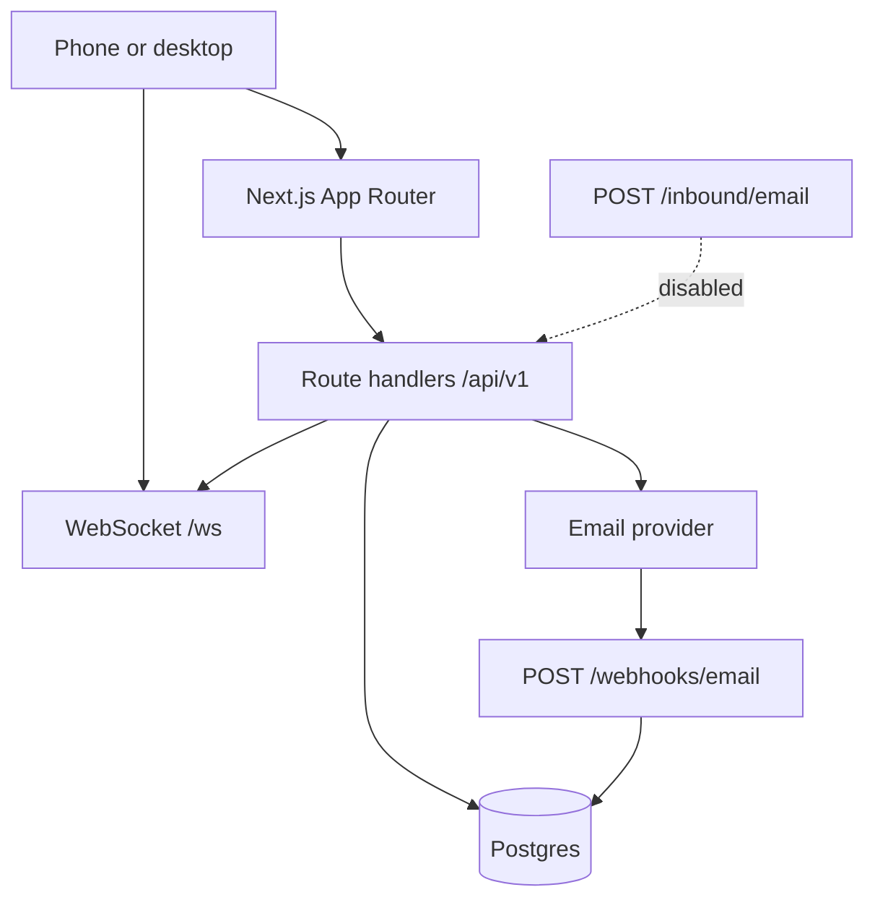

# Desk architecture

Decision record for the build that follows these documents. Nothing here is installed yet.

## Shape

One Next.js application. The App Router serves the screens. Route handlers under `app/api/v1` serve the API in [openapi.yaml](openapi.yaml). Tailwind implements the tokens in [design-system.md](design-system.md). Postgres holds the data. A WebSocket server runs in the same Node process as Next.js, because the desk is an internal app on a long-lived machine, not a serverless function.



The WebSocket is how notifications and thread updates arrive while the app is open. The email provider is how receipts leave the building. The inbound email route is drawn as a dotted line because the contract exists and the switch is off. See [email.md](email.md).

## Why one process

Staff will run this on the company VPS, next to other internal services. A custom Node server can host Next.js and `ws` together, so a ticket write and its socket event happen in one place. There is no second realtime vendor to operate.

If a later host is serverless and cannot hold a socket, clients fall back to the SSE stream described in [realtime.md](realtime.md). The events and the sound keys stay the same. The transport is the only change. Do not design a second notification model for that day.

## Data

Postgres. Tables, named for the product words:

- `departments` — the nine slugs, seeded, not user-created
- `users` — person, home department, role, password hash, active flag
- `department_recipients` — who is copied for a department queue
- `department_watches` — extra departments a person watches
- `tickets` — the fields in [product.md](product.md), including the human id
- `messages` — notes on a ticket, in order
- `attachments` — file metadata and storage key, hanging off a message
- `watchers` — ticket-level followers
- `notifications` — one row per recipient per event, including an admin outreach
- `outreaches` — an admin’s note to a department, the unresolved count, and the ticket ids at that moment
- `receipts` — one row per outbound email, with addresses and state. A ticket receipt has a ticket id. An outreach receipt has an outreach id
- `sessions` — server-side session, httpOnly cookie on the client

Section badges are counted from tickets and unread notifications. They are not a separate table.

Ids inside the database are UUIDs. The human ticket id is a separate unique column, allocated from a Postgres sequence starting at 1001, formatted `VC-{n}`.

Passwords are hashed with Argon2id. The hash never appears in an API response.

Attachments go to disk on the VPS under a path outside the repo, or to an S3-compatible bucket if one is already in use. The database stores the key, the name, the media type, and the size. Bytes are not stored in Postgres.

## Auth

Session cookie, `HttpOnly`, `Secure`, `SameSite=Lax`, path `/`. The cookie value is a random token. The server stores only a hash of it.

The browser calls the API on the same site, so the cookie is enough. There is no bearer token in this version. The WebSocket handshake sends the cookie. A socket without a valid session is closed.

Login is rate-limited per email and per IP. A disabled user receives the same failure as a wrong password.

## Email

Outbound mail goes through Nodemailer in `lib/mail.ts`. It uses the SMTP server in `SMTP_HOST`. There is no hosted mail API. If `SMTP_HOST` is unset, the receipt is saved and the message is printed in the server log.

The app renders [email/ticket.html](email/ticket.html) and [email/ticket.txt](email/ticket.txt) with the ticket fields. It stores a receipt row before the send (`queued`), then updates it from the provider response and from `POST /api/v1/webhooks/email`.

`POST /api/v1/inbound/email` is specified and returns 501 until reply-by-email is turned on. The handler must exist so the contract is real, and it must not parse mail into tickets while it is off.

## Realtime

After a successful write, the API publishes one event to the sockets of every recipient. The event names and payloads are in [realtime.md](realtime.md). The publisher is in-process. Do not add Redis until more than one Node process is serving the desk. If that happens, the publish step moves behind a small interface. The event shape does not change.

## Suggested layout for the later build

This is a map, not a scaffold to create now.

```
app/                  screens and route handlers
components/           the components in the design system
lib/db/               schema and queries
lib/mail/             template render and provider
lib/realtime/         socket publish
docs/                 these documents
```

Tailwind theme tokens map one-to-one onto the tokens in the design system. No second palette in component files.

## What this record refuses

- A separate frontend repo and a separate API repo
- A public signup
- Storing mail credentials or session tokens in the repository
- Turning on inbound email parsing before the mailbox and the token format in [email.md](email.md) are accepted
- A dashboard service, a queue broker, or a microservice per department
