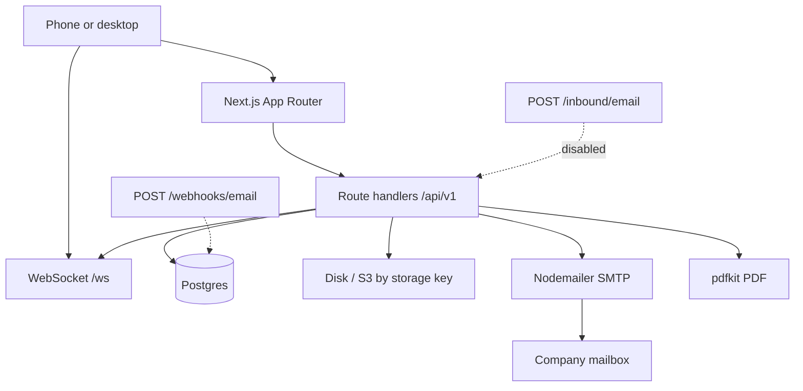

# Desk architecture

How Desk is put together. Local Postgres and the VPS path are in [postgres.md](postgres.md). Mail is in [email.md](email.md).

## Shape

One Next.js application. The App Router serves the screens. Route handlers under `app/api/v1` serve the API in [openapi.yaml](openapi.yaml). Tailwind implements the tokens in [design-system.md](design-system.md). Postgres holds the data. A WebSocket server runs in the same Node process as Next.js, because the desk is an internal app on a long-lived machine, not a serverless function.



The WebSocket is how notifications and thread updates arrive while the app is open. Mail leaves through Nodemailer and the SMTP server in `SMTP_HOST`. The webhook and the inbound route are dotted because SMTP does not call back, and reply-by-email is off. See [email.md](email.md).

## Why one process

Staff will run this on the company VPS, next to other internal services. A custom Node server can host Next.js and `ws` together, so a ticket write and its socket event happen in one place. There is no second realtime vendor to operate.

If a later host is serverless and cannot hold a socket, clients fall back to the SSE stream described in [realtime.md](realtime.md). The events and the sound keys stay the same. The transport is the only change. Do not design a second notification model for that day.

## Data

Postgres. Tables, named for the product words:

- `departments` — the nine slugs, seeded, not user-created
- `users` — person, home department, role, password hash, active flag
- `department_recipients` — who is copied for a department queue
- `department_watches` — extra departments a person watches
- `tickets` — the fields in [product.md](product.md), including the human id
- `messages` — notes on a ticket, in order
- `attachments` — file metadata and storage key, hanging off a message
- `watchers` — ticket-level followers
- `notifications` — one row per recipient per event, including an admin outreach
- `outreaches` — an admin’s note to a department, the unresolved count, and the ticket ids at that moment
- `receipts` — one row per outbound email, with addresses and state. A ticket receipt has a ticket id. An outreach receipt has an outreach id
- `sessions` — server-side session, httpOnly cookie on the client
- `tasks` — assigned work with a `TSK-` human id, fields, status and stage times
- `task_steps` — delegated steps, receiving department and head, step status and stage times
- `task_resources` — links and file evidence; files carry a `storage_key`
- `task_comments` — discussion on the task
- `task_activities` — the activity timeline on the task
- `task_reminder_deliveries` — one row per reminder, unique on `(task_id, user_id, kind, scheduled_for)`

Section badges are counted from tickets, task state and unread notifications. They are not a separate table. The Tasks badge covers active tasks assigned to the person, plus tasks they delegated that are in review.

Ids inside the database are UUIDs. The human ticket id is a separate unique column, allocated from a Postgres sequence starting at 1001, formatted `VC-{n}`. Task ids come from the `task_no` sequence, also starting at 1001, formatted `TSK-{n}`; the sequence never resets. The task tables are in `schema.sql` for a fresh install and in `migrations/005_tasks.sql`, registered as version 5, for existing databases.

Passwords are hashed with Argon2id. The hash never appears in an API response.

Attachments go to disk on the VPS under a path outside the repo, or to an S3-compatible bucket if one is already in use. The database stores the key, the name, the media type, and the size. Bytes are not stored in Postgres. Task evidence files use the same store and are served from a private task download route; links are stored as URLs.

## Tasks

Task routes run in the same catch-all handler as tickets (`app/api/v1/[[...path]]/route.ts`, with the logic in `lib/handle.ts`). `/tasks` and `/task-steps/{id}` cover creation, list filters, the status transitions, steps, evidence and comments. One report builder feeds `GET /reports/tasks/data` and the CSV, PDF and handoffs CSV exports. PDFs are rendered in-process with `pdfkit` on A4 pages; CSV is written in the handler as an attachment. Report ranges use Africa/Lagos boundaries: 00:00+01:00 days, Monday-start weeks and calendar months.

There is no long-lived reminder scheduler. `GET /notifications/status` delivers reminders already due for the signed-in person, and `POST /tasks/reminders/run` is the admin-only trigger for cron or a manual click. A delivery and its `task_reminder_deliveries` row are written in one transaction; the unique key on `(task_id, user_id, kind, scheduled_for)` makes repeats harmless.

## Auth

Session cookie, `HttpOnly`, `Secure`, `SameSite=Lax`, path `/`. The cookie value is a random token. The server stores only a hash of it.

The browser calls the API on the same site, so the cookie is enough. There is no bearer token in this version. The WebSocket handshake sends the cookie. A socket without a valid session is closed.

Login is rate-limited per email and per IP. A disabled user receives the same failure as a wrong password.

## Email

`lib/mail.ts` renders [email/ticket.html](email/ticket.html) and [email/ticket.txt](email/ticket.txt), then sends them with Nodemailer. There is no hosted mail API.

`SMTP_HOST` is the mail server. `SMTP_PORT` defaults to 587. Port 465, or `SMTP_SECURE=true`, turns on TLS from the first byte. `SMTP_USER` and `SMTP_PASS` are sent when a user is set. `EMAIL_FROM` is the From address. Nodemailer sets `Message-ID` to `<receipt-id@desk.vethancon.com>`, `Reply-To` to `noreply@desk.vethancon.com`, and the `X-Desk-Ticket` and `X-Desk-Event` headers.

The receipt row is inserted as `queued` before the send. A successful SMTP accept, and the log-only path when `SMTP_HOST` is unset, set the row to `sent` and store that message id. A thrown send sets the row to `failed`. The ticket write still stands. `POST /api/v1/webhooks/email` can still move a known message id to `sent` or `failed`. Nodemailer does not call it.

`POST /api/v1/inbound/email` returns 501 until reply-by-email is turned on. It does not parse mail into tickets.

## Realtime

After a successful write, the API publishes one event to the sockets of every recipient. The event names and payloads are in [realtime.md](realtime.md). Task writes publish `task.*` frames with `ticketEvent: { type: "task.<action>", taskId, action }` and sound `status`; the client provider refreshes task views on those frames. The publisher is in-process. Do not add Redis until more than one Node process is serving the desk. If that happens, the publish step moves behind a small interface. The event shape does not change.

## Layout

```
app/                  screens and route handlers
components/           the components in the design system
lib/db.ts             SQL, schema apply, and seed
lib/mail.ts           template render and Nodemailer
lib/realtime.ts       socket publish
server.ts             Next.js and the WebSocket on one port
docs/                 these documents
```

Tailwind theme tokens map one-to-one onto the tokens in the design system. No second palette in component files.

## What this record refuses

- A separate frontend repo and a separate API repo
- A separate task service, or a long-lived reminder scheduler in the app process
- A public signup
- Storing mail credentials or session tokens in the repository
- Turning on inbound email parsing before the mailbox and the token format in [email.md](email.md) are accepted
- A dashboard service, a queue broker, or a microservice per department
